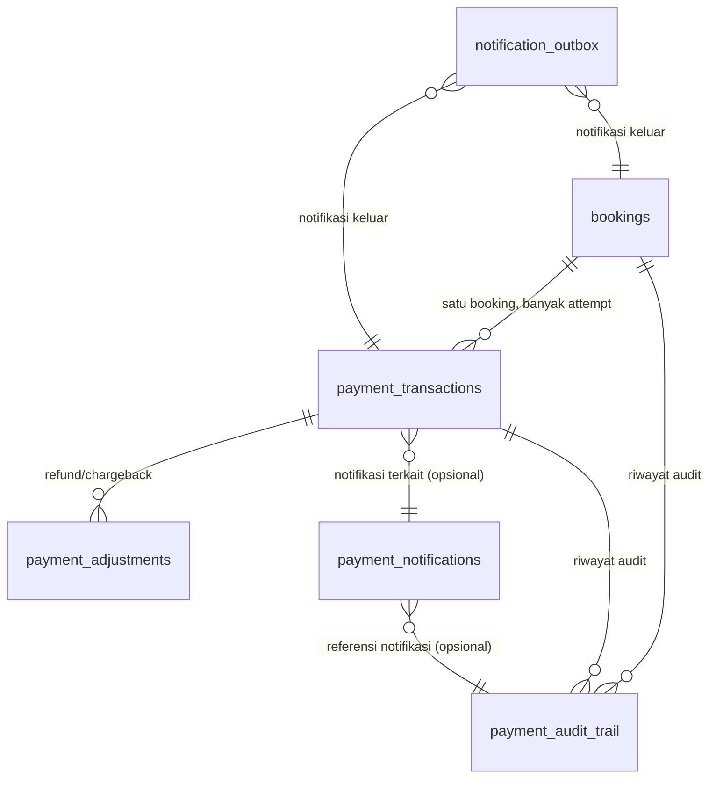
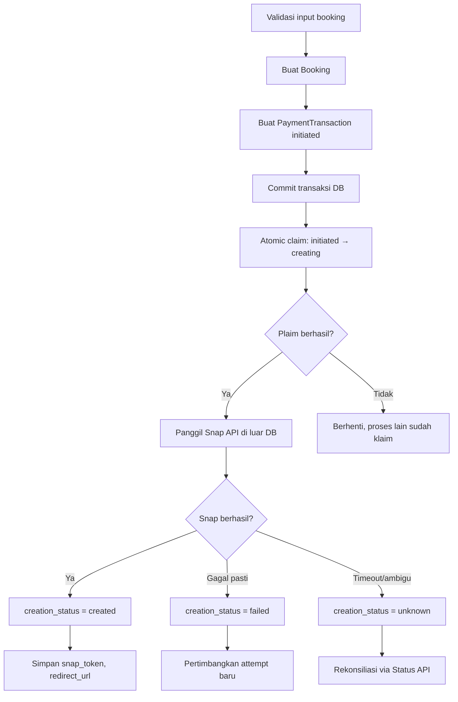
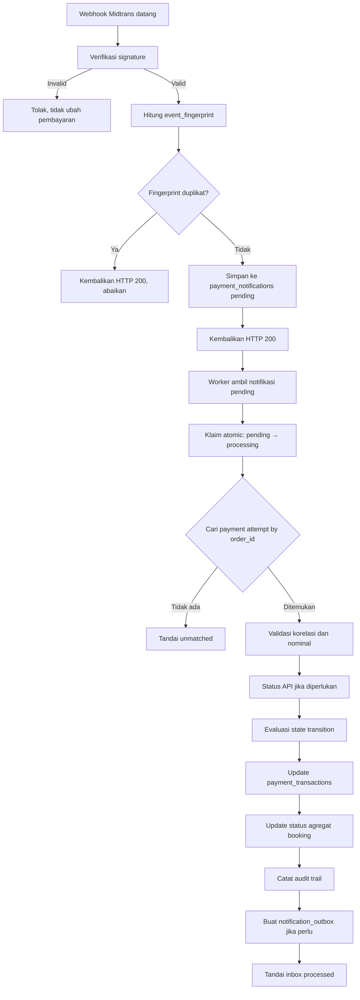
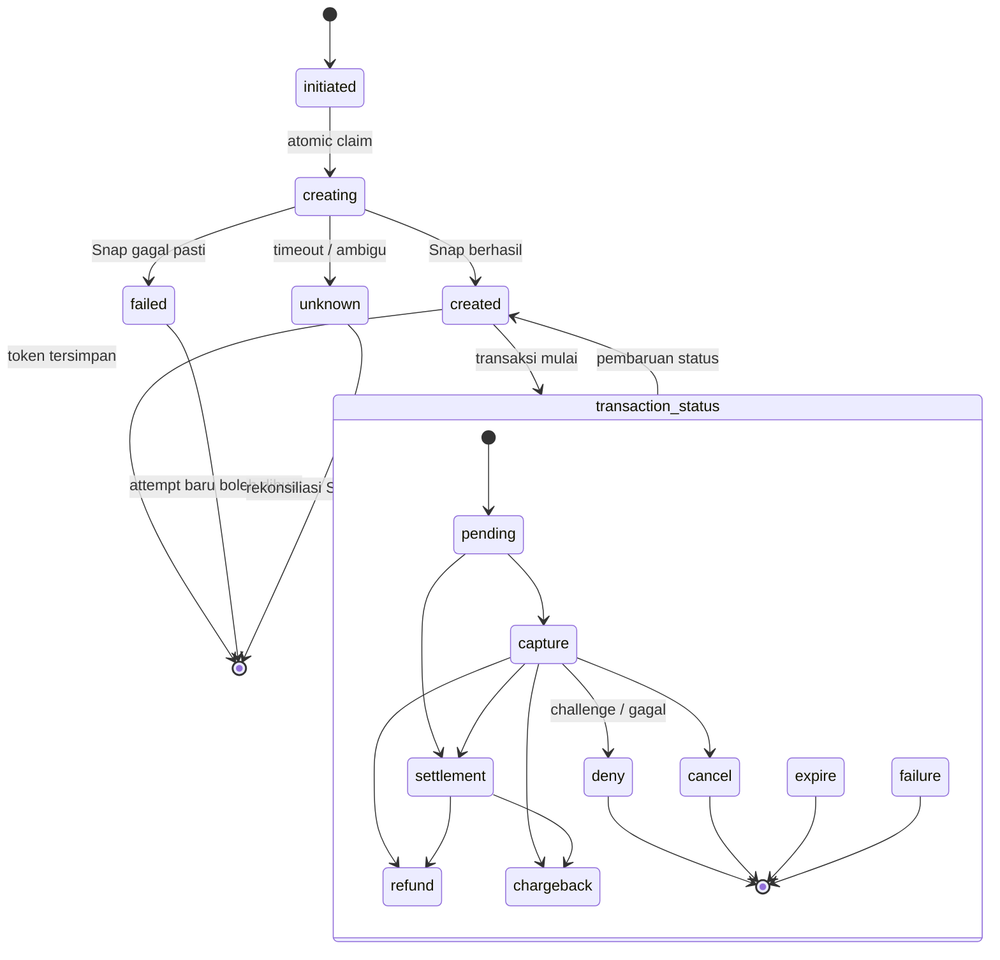

# Rancangan Refactor Pembayaran Midtrans

## Final — Revisi Keempat (Final Technical Audit)

**Status dokumen:** Menunggu persetujuan eksplisit  
**Status implementasi:** Belum diimplementasikan  
**Stack:** Laravel, PHP, MySQL, Midtrans Snap, Filament  
**Tujuan:** Memperbaiki korelasi transaksi, inisiasi pembayaran, webhook, retry, rekonsiliasi, refund, audit trail, dan status pembayaran booking.

> **PENTING:** Dokumen ini merupakan rancangan teknis. Tidak ada source code, migration, database, konfigurasi, maupun file `.env` yang boleh diubah sebelum pemilik proyek memberikan persetujuan eksplisit.

---

# 1. Tujuan dan Prinsip Arsitektur

Refactor ini bertujuan memastikan setiap pembayaran memiliki identitas transaksi yang konsisten, dapat direkonsiliasi, tidak menyebabkan pembayaran ganda akibat retry, serta mempunyai jejak audit yang dapat ditelusuri.

Prinsip utama:

1. Satu booking dapat mempunyai beberapa payment attempt.
2. Setiap payment attempt memiliki `order_id` Midtrans sendiri.
3. `order_id` Midtrans harus terhubung dengan satu payment attempt internal.
4. Panggilan API Midtrans tidak dilakukan di dalam transaksi database yang panjang.
5. Webhook harus diverifikasi sebelum diproses sebagai notifikasi tepercaya.
6. Pemrosesan webhook harus idempotent.
7. Status transaksi individual tidak boleh disamakan dengan status agregat pembayaran booking.
8. Refund dan chargeback harus tercatat sebagai kejadian tersendiri.
9. Status pembayaran tidak boleh ditentukan hanya berdasarkan callback frontend.
10. Setiap perubahan status penting harus memiliki audit trail.
11. Kondisi ambigu tidak boleh dianggap berhasil maupun gagal tanpa bukti.
12. Sistem harus dapat pulih dari worker mati, timeout, webhook duplikat, dan gangguan Midtrans.

## 1.1 Pembagian Komponen

| Komponen | Tanggung jawab | Status |
|---|---|---|
| Booking | Menyimpan informasi pemesanan | Existing |
| PaymentTransaction | Menyimpan setiap payment attempt | Baru |
| PaymentNotification | Menyimpan webhook Midtrans yang sudah diverifikasi (inbox) | Baru |
| PaymentAdjustment | Menyimpan refund dan penyesuaian pembayaran | Baru |
| PaymentAuditTrail | Menyimpan riwayat perubahan status | Baru |
| PaymentInitiationService | Mengelola pembuatan Snap session | Baru |
| PaymentValidationService | Memvalidasi identitas, nominal, dan mata uang | Baru |
| PaymentReconciliationService | Memeriksa status melalui Status API | Baru |
| PaymentAggregateStatusService | Menentukan status pembayaran booking | Baru |
| PaymentStatusPolicy | Menentukan apakah transaksi dianggap berhasil | Baru |
| PaymentNotificationProcessor | Memproses inbox webhook melalui worker | Baru |
| NotificationOutbox | Menyimpan pekerjaan notifikasi keluar (opsional) | Baru, jika kanal tersedia |

**Catatan:** `PaymentAttempt` adalah istilah konseptual. Nama tabel dan model yang digunakan secara konsisten adalah `payment_transactions` dan `PaymentTransaction`. `notification_outbox` hanya dibuat jika aplikasi benar-benar memiliki kanal pengiriman notifikasi keluar yang akan diproses.

---

# 2. Struktur Database

## 2.1 Tabel `bookings`

Tabel booking tetap menjadi sumber informasi pemesanan. Tidak ada kolom baru yang ditambahkan ke tabel ini dalam rancangan ini, kecuali jika pemeriksaan source code aktual menunjukkan kebutuhan.

Kolom pembayaran yang relevan dan sudah ada:

| Kolom | Keterangan |
|---|---|
| `id` | Primary key booking |
| `reference` | Referensi unik booking |
| `total_amount` | Total nominal booking |
| `payment_status` | Status agregat pembayaran |
| `midtrans_order_id` | Kolom legacy, dipertahankan untuk kompatibilitas |
| `midtrans_snap_token` | Kolom legacy, dipertahankan untuk kompatibilitas |

**Ketentuan:**

- Jangan mengubah struktur kolom lama sebelum tipe data dan penggunaan aktualnya diperiksa.
- `midtrans_order_id` tidak lagi menjadi satu-satunya sumber identitas transaksi.
- `midtrans_snap_token` tidak lagi menjadi satu-satunya sumber token pembayaran.
- Sumber kebenaran pembayaran baru adalah relasi `bookings` dengan `payment_transactions`.
- `booking.status` tetap terpisah dari `booking.payment_status`.
- Jangan menambahkan kolom `currency` ke `bookings` tanpa kebutuhan dan pemeriksaan struktur aktual.

## 2.2 Tabel `payment_transactions`

Tabel ini menjadi sumber kebenaran untuk setiap percobaan pembayaran.

| Kolom | Tipe yang disarankan | Nullable | Keterangan |
|---|---|---|---|
| `id` | BIGINT | No | Primary key internal (auto-increment) |
| `booking_id` | BIGINT | No | Foreign key ke `bookings.id` |
| `order_id` | VARCHAR(50) | No | Order ID unik Midtrans untuk attempt ini |
| `transaction_id` | VARCHAR(100) | Yes | ID transaksi Midtrans, nullable sebelum tersedia |
| `payment_type` | VARCHAR(50) | Yes | Metode pembayaran Midtrans |
| `creation_status` | VARCHAR(30) | No | Status pembuatan Snap (`initiated`, `creating`, `created`, `failed`, `unknown`) |
| `transaction_status` | VARCHAR(30) | Yes | Status transaksi Midtrans |
| `fraud_status` | VARCHAR(30) | Yes | Status fraud Midtrans |
| `gross_amount` | BIGINT | No | Nominal request Snap dalam rupiah integer |
| `currency` | VARCHAR(10) | No | Mata uang, default `IDR` |
| `snap_token` | TEXT | Yes | Token Snap dari Midtrans |
| `redirect_url` | TEXT | Yes | URL redirect Snap |
| `response` | LONGTEXT | Yes | Respons Snap yang tersimpan (JSON) |
| `creation_started_at` | TIMESTAMP | Yes | Waktu mulai pembuatan Snap |
| `creation_lease_until` | TIMESTAMP | Yes | Batas waktu lease atomic claim |
| `creation_attempt_count` | INTEGER | No (default: 0) | Jumlah percobaan pembuatan Snap |
| `creation_error` | TEXT | Yes | Error terakhir saat pembuatan Snap |
| `paid_at` | TIMESTAMP | Yes | Waktu transaksi dinyatakan berhasil |
| `last_reconciled_at` | TIMESTAMP | Yes | Waktu pemeriksaan Status API terakhir |
| `created_at` | TIMESTAMP | No | Waktu pembuatan |
| `updated_at` | TIMESTAMP | No | Waktu perubahan |

### Index dan constraint

- `PRIMARY KEY (id)`
- `UNIQUE KEY uk_order_id (order_id)`
- `UNIQUE KEY uk_transaction_id (transaction_id)` — MySQL mengizinkan multiple NULL pada kolom UNIQUE nullable
- Index `idx_booking_id` pada `booking_id`
- Index `idx_creation_status` pada `creation_status`
- Index `idx_transaction_status` pada `transaction_status`
- Index `idx_creation_lease_until` pada `creation_lease_until`

Foreign key:

`payment_transactions.booking_id → bookings.id` dengan `ON DELETE RESTRICT`

**Ketentuan penting:**

- `order_id` harus unik untuk setiap payment attempt. Maksimum panjang 50 karakter sesuai batasan Midtrans.
- Gunakan karakter yang diperbolehkan Midtrans untuk `order_id`.
- UUID 36 karakter dapat digunakan sebagai dasar identitas order ID.
- Jangan menggunakan reference booking yang sama untuk seluruh attempt.
- `transaction_id` boleh kosong sebelum Midtrans menghasilkan ID transaksi.
- `gross_amount` disimpan sebagai integer rupiah (satuan terkecil), bukan floating point.

## 2.3 Tabel `payment_notifications`

Tabel ini merupakan **inbox webhook Midtrans**, bukan outbox. Setiap notifikasi yang diterima dari Midtrans disimpan di sini sebelum diproses oleh worker.

| Kolom | Tipe | Nullable | Keterangan |
|---|---|---|---|
| `id` | BIGINT | No | Primary key |
| `event_fingerprint` | VARCHAR(64) | No | Hash SHA-256 dari payload yang dinormalisasi, unique |
| `order_id` | VARCHAR(50) | Yes | Order ID dari notifikasi Midtrans |
| `transaction_id` | VARCHAR(100) | Yes | Transaction ID Midtrans |
| `transaction_status` | VARCHAR(30) | Yes | Status dari notifikasi |
| `fraud_status` | VARCHAR(30) | Yes | Fraud status dari notifikasi |
| `gross_amount` | BIGINT | Yes | Nominal dari notifikasi |
| `currency` | VARCHAR(10) | Yes | Mata uang dari notifikasi |
| `payment_type` | VARCHAR(50) | Yes | Metode pembayaran |
| `status_code` | VARCHAR(10) | Yes | Status code Midtrans |
| `notification_signature` | VARCHAR(255) | Yes | Signature yang dikirim Midtrans dalam body webhook |
| `raw_payload` | LONGTEXT | Yes | Payload lengkap webhook |
| `processing_status` | VARCHAR(30) | No | `pending`, `processing`, `processed`, `failed`, `unmatched`, `review_required` |
| `attempt_count` | INTEGER | No (default: 0) | Jumlah percobaan pemrosesan |
| `last_error` | TEXT | Yes | Error terakhir saat pemrosesan |
| `received_at` | TIMESTAMP | No | Waktu notifikasi diterima |
| `processed_at` | TIMESTAMP | Yes | Waktu notifikasi selesai diproses |
| `created_at` | TIMESTAMP | No | Waktu dibuat |
| `updated_at` | TIMESTAMP | No | Waktu diperbarui |

### Index dan constraint

- `PRIMARY KEY (id)`
- `UNIQUE KEY uk_event_fingerprint (event_fingerprint)`
- Index `idx_order_id` pada `order_id`
- Index `idx_processing_status` pada `processing_status`
- Index `idx_received_at` pada `received_at`

Foreign key: tidak ada foreign key wajib pada tabel ini karena notifikasi dapat datang sebelum payment attempt tersedia.

### Identitas event webhook (`event_fingerprint`)

Jangan mengasumsikan Midtrans selalu menyediakan `event_id` unik pada setiap notifikasi.

`event_fingerprint` dihitung sebagai SHA-256 dari payload yang telah dinormalisasi secara deterministik. Field yang digunakan untuk membentuk fingerprint:

- `order_id`
- `transaction_id` (jika tersedia)
- `status_code`
- `transaction_status`
- `gross_amount`
- `fraud_status` (jika tersedia)
- Identitas refund/chargeback jika tersedia (misalnya `refund_id` atau `chargeback_id`)
- Informasi konfirmasi bank seperti `bank_confirmed_at` jika tersedia

Payload harus dinormalisasi (urutkan kunci, hilangkan spasi, standarkan format nominal) sebelum di-hash.

Tujuan `event_fingerprint`:

- Notifikasi identik menghasilkan fingerprint identik → mencegah pemrosesan berulang.
- Perubahan status seperti `capture` menjadi `settlement` menghasilkan fingerprint berbeda → dapat diproses sebagai event baru.
- Dua refund yang berbeda menghasilkan fingerprint berbeda → tidak dianggap sebagai event yang sama.
- Notifikasi refund sebelum dan sesudah `bank_confirmed_at` dapat dibedakan jika payload berbeda.

**Penting:** `event_fingerprint` hanya mencegah event identik diproses berulang. Perlindungan terhadap perubahan status yang tidak valid tetap harus dilakukan oleh `PaymentStatusPolicy` dan state transition service.

## 2.4 Tabel `payment_adjustments`

Tabel ini mencatat refund dan penyesuaian dana secara terpisah dari transaksi asli. Satu transaksi dapat mengalami lebih dari satu refund parsial atau chargeback.

| Kolom | Tipe | Nullable | Keterangan |
|---|---|---|---|
| `id` | BIGINT | No | Primary key |
| `payment_transaction_id` | BIGINT | No | Foreign key ke `payment_transactions.id` |
| `provider_adjustment_id` | VARCHAR(100) | Yes | ID refund/chargeback dari Midtrans jika tersedia |
| `adjustment_key` | VARCHAR(100) | Yes | Referensi unik refund dari merchant jika tersedia |
| `adjustment_type` | VARCHAR(30) | No | `refund`, `partial_refund`, `chargeback`, `partial_chargeback` |
| `amount` | BIGINT | No | Nominal penyesuaian dalam rupiah integer |
| `currency` | VARCHAR(10) | No | Mata uang |
| `adjustment_status` | VARCHAR(30) | No | Status penyesuaian (`pending`, `confirmed`, `reversed`, `failed`) |
| `bank_confirmed_at` | TIMESTAMP | Yes | Waktu konfirmasi bank jika tersedia |
| `raw_payload` | LONGTEXT | Yes | Data pendukung dari Midtrans |
| `created_at` | TIMESTAMP | No | Waktu dibuat |
| `updated_at` | TIMESTAMP | No | Waktu diperbarui |

### Index dan constraint

- `PRIMARY KEY (id)`
- `UNIQUE KEY uk_provider_adjustment (provider_adjustment_id)` — hanya jika `provider_adjustment_id` tidak NULL
- Index `idx_payment_transaction_id` pada `payment_transaction_id`
- Index `idx_adjustment_type` pada `adjustment_type`
- Index `idx_adjustment_status` pada `adjustment_status`

Foreign key:

`payment_adjustments.payment_transaction_id → payment_transactions.id` dengan `ON DELETE RESTRICT`

**Ketentuan:**

- Jangan hanya menyimpan satu `refund_amount` dan satu `refunded_at` pada `payment_transactions`.
- Jangan menjadikan `transaction_status` sebagai satu-satunya identitas refund.
- Jangan menganggap dua notifikasi refund dengan nominal sama pasti merupakan refund yang sama.
- Jika identitas provider tidak tersedia, gunakan kombinasi identitas internal yang deterministik (misalnya `payment_transaction_id` + `adjustment_type` + `amount` + `created_at`).

## 2.5 Tabel `payment_audit_trail`

| Kolom | Tipe | Nullable | Keterangan |
|---|---|---|---|
| `id` | BIGINT | No | Primary key |
| `booking_id` | BIGINT | No | Foreign key ke `bookings.id` |
| `payment_transaction_id` | BIGINT | Yes | Foreign key ke `payment_transactions.id`, nullable jika belum diketahui |
| `notification_id` | BIGINT | Yes | Referensi ke `payment_notifications.id`, nullable |
| `midtrans_transaction_id` | VARCHAR(100) | Yes | Transaction ID Midtrans |
| `payment_status_before` | VARCHAR(30) | Yes | Status agregat booking sebelum perubahan |
| `payment_status_after` | VARCHAR(30) | Yes | Status agregat booking setelah perubahan |
| `transaction_status_before` | VARCHAR(30) | Yes | Status transaksi Midtrans sebelum perubahan |
| `transaction_status_after` | VARCHAR(30) | Yes | Status transaksi Midtrans setelah perubahan |
| `fraud_status_before` | VARCHAR(30) | Yes | Fraud status sebelum perubahan |
| `fraud_status_after` | VARCHAR(30) | Yes | Fraud status setelah perubahan |
| `source` | VARCHAR(30) | No | Sumber perubahan (`webhook`, `status_api`, `admin`, `refund`, `chargeback`, `overpayment`, `manual_mapping`, `system_reconciliation`) |
| `actor_type` | VARCHAR(20) | No | `admin`, `system`, atau `webhook` |
| `actor_id` | VARCHAR(100) | Yes | ID aktor, nullable untuk sistem atau webhook |
| `nominal` | BIGINT | Yes | Nominal terkait perubahan dalam rupiah integer |
| `currency` | VARCHAR(10) | Yes | Mata uang |
| `description` | TEXT | Yes | Keterangan perubahan |
| `created_at` | TIMESTAMP | No | Waktu kejadian |

### Index dan constraint

- `PRIMARY KEY (id)`
- Index `idx_booking_id` pada `booking_id`
- Index `idx_payment_transaction_id` pada `payment_transaction_id`
- Index `idx_source` pada `source`
- Index `idx_created_at` pada `created_at`

Foreign key:

- `payment_audit_trail.booking_id → bookings.id` dengan `ON DELETE RESTRICT`
- `payment_audit_trail.payment_transaction_id → payment_transactions.id` dengan `ON DELETE RESTRICT`
- `payment_audit_trail.notification_id → payment_notifications.id` dengan `ON DELETE SET NULL`

**Ketentuan:**

- Audit tidak boleh gagal hanya karena aktor sistem atau webhook tidak memiliki user ID. `actor_id` nullable.
- Jangan menggunakan cascade delete yang dapat menghapus bukti transaksi keuangan.
- Simpan nilai sebelum dan sesudah perubahan untuk setiap perubahan status penting.

## 2.6 Tabel `notification_outbox` (Opsional)

Tabel ini bersifat opsional dan hanya dibuat jika aplikasi benar-benar memiliki kanal pengiriman notifikasi keluar yang akan diproses.

| Kolom | Tipe | Nullable | Keterangan |
|---|---|---|---|
| `id` | BIGINT | No | Primary key |
| `event_key` | VARCHAR(100) | No | Kunci idempotensi deterministik, unique |
| `booking_id` | BIGINT | Yes | Foreign key ke `bookings.id` |
| `payment_transaction_id` | BIGINT | Yes | Foreign key ke `payment_transactions.id` |
| `channel` | VARCHAR(30) | No | Kanal pengiriman (misalnya `whatsapp`, `email`) |
| `notification_type` | VARCHAR(50) | No | Jenis notifikasi (`payment_confirmed`, `payment_rejected`, `refund_confirmed`, dst) |
| `payload` | LONGTEXT | Yes | Isi notifikasi (JSON) |
| `status` | VARCHAR(30) | No | `pending`, `sent`, `failed` |
| `attempt_count` | INTEGER | No (default: 0) | Jumlah percobaan pengiriman |
| `max_attempts` | INTEGER | No (default: 3) | Batas percobaan |
| `last_error` | TEXT | Yes | Error terakhir |
| `provider_message_id` | VARCHAR(255) | Yes | ID pesan dari provider jika ada |
| `provider_response` | LONGTEXT | Yes | Respons mentah dari provider |
| `sent_at` | TIMESTAMP | Yes | Waktu provider mengonfirmasi pengiriman (hanya jika dikonfirmasi) |
| `created_at` | TIMESTAMP | No | Waktu dibuat |
| `updated_at` | TIMESTAMP | No | Waktu diperbarui |

### Index dan constraint

- `PRIMARY KEY (id)`
- `UNIQUE KEY uk_event_key (event_key)`
- Index `idx_status` pada `status`
- Index `idx_created_at` pada `created_at`
- Index `idx_channel` pada `channel`

Foreign key:

- `notification_outbox.booking_id → bookings.id` dengan `ON DELETE RESTRICT`
- `notification_outbox.payment_transaction_id → payment_transactions.id` dengan `ON DELETE RESTRICT`

**Ketentuan:**

- `sent_at` hanya diisi ketika provider mengonfirmasi pengiriman, bukan saat aplikasi mengirim request.
- Tidak ada tabel `whatsapp_outbox` terpisah. Jika nantinya dipilih WhatsApp Business API, gunakan `notification_outbox` dengan `channel = 'whatsapp'`.
- Jika aplikasi saat ini hanya menggunakan tautan `wa.me`, pengiriman masih manual dan aplikasi tidak dapat memastikan pesan benar-benar terkirim. Jangan mengubah status menjadi `sent` hanya karena tautan dibuka.
- Unique constraint pada `event_key` hanya menjamin deduplikasi pembuatan event di database, tidak menjamin pengiriman eksternal tepat satu kali (at-least-once, bukan exactly-once).

---

# 3. Relasi Eloquent

| Model | Relasi | Keterangan |
|---|---|---|
| `Booking` | `hasMany PaymentTransaction` | Satu booking boleh banyak payment attempt |
| `Booking` | `hasMany PaymentAuditTrail` | Riwayat audit per booking |
| `PaymentTransaction` | `belongsTo Booking` | Setiap attempt milik satu booking |
| `PaymentTransaction` | `hasMany PaymentAdjustment` | Refund/chargeback per attempt |
| `PaymentTransaction` | `hasMany PaymentAuditTrail` | Riwayat audit per attempt |
| `PaymentTransaction` | `hasMany PaymentNotification` | Notifikasi yang terkait dengan attempt ini (jika dipetakan) |
| `PaymentNotification` | `belongsTo PaymentTransaction` (opsional) | Notifikasi dapat belum dipetakan ke attempt |
| `PaymentAdjustment` | `belongsTo PaymentTransaction` | Setiap penyesuaian milik satu attempt |
| `NotificationOutbox` | `belongsTo Booking` | Notifikasi keluar terkait booking |
| `NotificationOutbox` | `belongsTo PaymentTransaction` | Notifikasi keluar terkait attempt |

**Catatan:** `PaymentNotification` tidak wajib memiliki foreign key ke `PaymentTransaction` karena notifikasi dapat datang sebelum payment attempt tersedia atau tidak dapat dipetakan.

---

# 4. State Machine Pembayaran

Pisahkan status pembuatan Snap (`creation_status`) dan status transaksi Midtrans (`transaction_status`).

## 4.1 `creation_status`

| Status | Arti | Perlakuan |
|---|---|---|
| `initiated` | Attempt dibuat, belum diklaim | Dapat diklaim worker untuk membuat Snap |
| `creating` | Pembuatan Snap sedang berlangsung | Tidak boleh diklaim proses lain selama lease aktif |
| `created` | Snap berhasil dibuat dan token tersimpan | Dapat digunakan pelanggan |
| `failed` | Kegagalan pembuatan dipastikan | Dapat dipertimbangkan membuat attempt baru |
| `unknown` | Hasil request ambigu (timeout, gangguan jaringan) | Wajib rekonsiliasi, jangan membuat order baru otomatis |

`unknown` bukan sinonim `failed`. Contoh kondisi `unknown`:

- Request timeout setelah dikirim ke Midtrans.
- Koneksi terputus ketika menunggu respons.
- Midtrans mungkin sudah membuat Snap session, tetapi aplikasi belum menerima token.

Pada kondisi tersebut, sistem tidak boleh menyimpulkan bahwa transaksi tidak pernah dibuat.

## 4.2 `transaction_status`

Simpan status Midtrans apa adanya sebagai string agar status baru tidak menyebabkan kegagalan enum database.

Status yang harus ditangani:

- `pending`
- `authorize`
- `capture`
- `settlement`
- `deny`
- `cancel`
- `expire`
- `failure`
- `refund`
- `partial_refund`
- `chargeback`
- `partial_chargeback`

Status yang tidak dikenal harus disimpan dan diarahkan ke review, bukan otomatis dianggap berhasil.

## 4.3 Definisi Transaksi Berhasil

Gunakan satu metode terpusat, misalnya `PaymentStatusPolicy::isSuccessful()`.

| Kondisi | Klasifikasi | Keterangan |
|---|---|---|
| `settlement` | Berhasil | Transaksi disetel |
| `capture` + `fraud_status = accept` | Berhasil | Transaksi kartu diterima, tidak perlu menunggu settlement |
| `capture` + `fraud_status = challenge` | Review | Jangan otomatis konfirmasi, perlu peninjauan |
| `capture` tanpa `fraud_status` | Evaluasi | Ikuti ketentuan metode pembayaran Midtrans |
| `authorize` | Tidak berhasil | Tidak otomatis dianggap dana diterima |
| `pending` | Menunggu | Transaksi masih diproses |
| `deny` | Gagal | Ditolak bank |
| `cancel` | Gagal | Dibatalkan |
| `expire` | Gagal | Kedaluwarsa |
| `failure` | Gagal | Gagal secara pasti |

**Penting:** Jangan menganggap seluruh status `capture` pasti membutuhkan `settlement` berikutnya. Transaksi kartu dengan `capture` yang diterima (`fraud_status = accept`) dapat dianggap berhasil sesuai ketentuan Midtrans.

Perubahan `capture` ke `settlement` pada transaksi yang sama tidak dihitung sebagai dua pembayaran. Perubahan `capture` ke `cancel` ditangani sebagai pembatalan. Event lama tidak boleh menimpa status terbaru secara sembarangan.

## 4.4 Aturan Reversal

Refund dan chargeback tidak boleh diperlakukan sebagai `deny`.

Pisahkan:

- Refund penuh (`refund`)
- Refund sebagian (`partial_refund`)
- Chargeback penuh (`chargeback`)
- Chargeback sebagian (`partial_chargeback`)
- Pembatalan sebelum pembayaran berhasil (`cancel`)
- Penolakan transaksi (`deny`)

Jangan menimpa histori sukses sebelumnya. Simpan setiap refund atau chargeback dalam `payment_adjustments` dan catat di `payment_audit_trail`.

---

# 5. Alur Inisiasi Pembayaran

## 5.1 Pembuatan Booking dan Payment Attempt

Urutan wajib:

1. Validasi input booking.
2. Validasi treatment, jadwal, promo, dan harga dari server.
3. Hitung nominal booking di backend.
4. Buat `Booking`.
5. Buat `PaymentTransaction` dengan `creation_status = initiated`.
6. Buat `order_id` unik untuk attempt tersebut (maksimal 50 karakter, karakter yang diperbolehkan Midtrans).
7. Simpan `gross_amount` dan `currency`.
8. Commit transaksi database.
9. Lakukan atomic claim pada payment attempt.
10. Panggil Snap API di luar transaksi database.
11. Simpan respons Snap ke payment attempt berdasarkan ID internal.
12. Jika berhasil, ubah `creation_status = created`.
13. Jika gagal secara pasti, ubah `creation_status = failed`.
14. Jika timeout atau hasil ambigu, ubah `creation_status = unknown`.

Jangan mempertahankan transaksi database terbuka selama request HTTP ke Midtrans.

## 5.2 Atomic Claim

Gunakan conditional update untuk memastikan hanya satu proses yang dapat mengklaim attempt.

Contoh konsep (MySQL):

```sql
UPDATE payment_transactions
SET
    creation_status = 'creating',
    creation_lease_until = ?,
    creation_attempt_count = creation_attempt_count + 1,
    creation_started_at = ?,
    updated_at = ?
WHERE
    id = ?
    AND creation_status = 'initiated';
```

Nilai timestamp dihitung dan disimpan secara konsisten menggunakan timezone database yang ditetapkan aplikasi. Jangan menggunakan sintaks interval PostgreSQL seperti `INTERVAL '10 minutes'`. Gunakan parameter timestamp yang dihitung oleh aplikasi atau sintaks MySQL yang benar.

- Jika `affected rows = 1`, proses memperoleh klaim dan boleh memanggil Snap API.
- Jika `affected rows = 0`, proses lain sudah mengklaim; proses ini berhenti dan tidak membuat Snap session duplikat.

## 5.3 Penanganan Lease Kedaluwarsa

Lease hanya mencegah dua proses menjalankan pembuatan Snap secara bersamaan. Lease tidak membuktikan bahwa request sebelumnya gagal.

Ketika lease kedaluwarsa (`creation_lease_until < sekarang`):

1. Worker memeriksa attempt yang bersangkutan.
2. Periksa apakah respons Snap sudah tersimpan.
3. Periksa apakah webhook telah diterima.
4. Periksa Status API jika transaksi dapat ditemukan.
5. Jika hasil masih ambigu, pertahankan `creation_status = unknown`.
6. Jangan membuat `order_id` baru secara otomatis.
7. Jangan mengirim ulang request Snap dengan asumsi bahwa order ID lama pasti belum digunakan.

**Kasus penting:** Jika Snap berhasil dibuat di Midtrans tetapi respons token hilang akibat timeout, Status API dapat belum menemukan transaksi karena pelanggan belum memilih metode pembayaran. Dalam kondisi tersebut token Snap lama mungkin tidak dapat dipulihkan melalui Status API.

Sistem harus:

- Mempertahankan status `unknown`.
- Menandai attempt untuk pemeriksaan admin.
- Menyediakan prosedur rekonsiliasi manual melalui informasi transaksi di Midtrans Dashboard atau dukungan Midtrans.
- Tidak membuat payment attempt baru sampai risiko sesi pembayaran lama diputuskan.
- Mencatat keputusan dan bukti pemeriksaan pada `payment_audit_trail`.

Jangan menjanjikan pemulihan token Snap otomatis jika API tidak menyediakan mekanismenya.

## 5.4 Retry dan Order ID

Setiap payment attempt baru harus memiliki `order_id` baru. Bedakan tiga kondisi:

1. **Retry HTTP request yang sama** — gunakan mekanisme idempotensi yang memang didukung endpoint terkait (jika ada).
2. **Kegagalan pembuatan Snap yang sudah dapat dipastikan** — dapat membuat attempt baru dengan `order_id` baru.
3. **Timeout atau hasil request ambigu** — jangan membuat attempt baru. Pertahankan `unknown` dan gunakan Status API untuk rekonsiliasi.

Jangan menganggap semua retry boleh menggunakan order ID yang sama. Jangan membuat attempt baru ketika hasil attempt lama masih ambigu.

Jika dokumentasi Midtrans mendukung `Idempotency-Key` untuk endpoint yang digunakan, jelaskan batas waktu, cakupan endpoint, dan cara menggunakannya. Jangan mengklaim Snap API mendukungnya sebelum endpoint tersebut diverifikasi.

---

# 6. Alur Webhook dan Inbox

## 6.1 Verifikasi Signature

Verifikasi signature dilakukan sebelum notifikasi disimpan sebagai event tepercaya.

Gunakan konfigurasi rahasia:

- **Server Key** — untuk autentikasi request API Midtrans (Status API, Snap API).
- **Signature Secret Key** — untuk menghitung dan memverifikasi signature notifikasi webhook sesuai dokumentasi Midtrans yang berlaku.
- **`notification_signature`** — signature yang diterima dalam body webhook dari Midtrans, bukan secret key.

Rumus verifikasi signature (sesuai dokumentasi Midtrans):

```text
SHA512(order_id + status_code + gross_amount + SignatureSecretKey)
```

Ketentuan:

1. Ambil `notification_signature` dari body notifikasi.
2. Ambil `order_id`, `status_code`, dan `gross_amount` dari body.
3. Gunakan representasi string nominal persis seperti yang diterima ketika menghitung signature.
4. Jangan mengubah nominal menjadi float sebelum proses verifikasi.
5. Gunakan perbandingan constant-time seperti `hash_equals`.
6. Jangan pernah mengekspos secret key melalui frontend, log, atau respons HTTP.

Jika signature tidak valid atau field wajib tidak tersedia:

- Jangan memperbarui status transaksi.
- Jangan memperbarui booking.
- Jangan membuat entri `notification_outbox`.
- Catat kegagalan keamanan secara terbatas.
- Terapkan rate limit dan batas ukuran payload.
- Jangan menyimpan payload sensitif tanpa batas.

Field wajib dalam payload webhook: `order_id`, `status_code`, `gross_amount`, `notification_signature`, `transaction_id`, `transaction_status`, `fraud_status`, `currency`, `payment_type`.

## 6.2 Proses Penerimaan Webhook

Urutan:

1. Terima HTTP request.
2. Validasi struktur payload.
3. Verifikasi signature.
4. Hitung `event_fingerprint` dari payload yang dinormalisasi.
5. Simpan notifikasi ke `payment_notifications` dengan `processing_status = pending`.
6. Jika `event_fingerprint` sudah ada, perlakukan sebagai duplikat dan jangan simpan duplikat.
7. Jika penyimpanan berhasil, kembalikan HTTP 200 kepada Midtrans.
8. Worker memproses inbox secara terpisah (bukan dalam request webhook).

Jika database gagal menyimpan notifikasi, jangan mengembalikan HTTP 200. Biarkan Midtrans mencoba mengirim ulang sesuai mekanisme notifikasinya.

## 6.3 Pemrosesan Inbox (Worker)

Worker `PaymentNotificationProcessor`:

1. Mengambil notifikasi dengan `processing_status = pending`.
2. Mengklaimnya secara atomic (update ke `processing`).
3. Mencari payment attempt berdasarkan `order_id`.
4. Jika tidak ditemukan, tandai `processing_status = unmatched`.
5. Jika ditemukan, validasi korelasi transaksi (`order_id`, `transaction_id`, `currency`, `gross_amount`).
6. Ambil Status API jika diperlukan untuk verifikasi tambahan atau rekonsiliasi.
7. Validasi nominal dan mata uang melalui `PaymentValidationService`.
8. Evaluasi state transition melalui `PaymentStatusPolicy`.
9. Perbarui `payment_transactions`.
10. Perbarui status agregat booking melalui `PaymentAggregateStatusService`.
11. Catat audit trail ke `payment_audit_trail`.
12. Buat entri `notification_outbox` jika ada kanal notifikasi yang aktif.
13. Tandai inbox `processing_status = processed`.

Langkah 9–13 harus dilakukan dalam satu transaksi database.

Jika proses gagal, rollback seluruh perubahan bisnis dan tandai event untuk retry dengan error yang aman di `last_error`.

## 6.4 Webhook Datang Sebelum Respons Snap Tersimpan

Kasus ini harus didukung karena payment attempt dibuat sebelum Snap API dipanggil.

- Webhook tetap disimpan ke inbox.
- Jangan langsung membuang notifikasi.
- Worker mencari berdasarkan `order_id`.
- Jika payment attempt sudah ada, event dapat diproses setelah validasi.
- Jika belum dapat dipetakan, pertahankan sebagai `unmatched`.
- Lakukan rekonsiliasi kembali setelah data inisiasi tersedia.

Karena payment attempt dibuat sebelum Snap API dipanggil, `order_id` sudah tersedia di database sebelum webhook mungkin diterima.

---

# 7. Validasi Nominal dan Identitas

## 7.1 Korelasi Transaksi

Sebelum mengubah status pembayaran, pastikan:

- `order_id` cocok dengan `payment_transactions.order_id`.
- `transaction_id` konsisten jika sebelumnya sudah tersimpan.
- `currency` sesuai dengan mata uang booking.
- `gross_amount` sesuai dengan `payment_transactions.gross_amount`.
- Payment attempt terhubung ke booking yang benar.
- Status transaksi berasal dari sumber yang dapat dipercaya (webhook yang diverifikasi atau Status API).

Jangan mencari booking hanya dengan `reference` jika Midtrans mengirim `order_id` yang berbeda. Gunakan `order_id` dari notifikasi untuk mencari `PaymentTransaction`, lalu ambil `booking_id` dari situ.

## 7.2 Format Nominal

Midtrans Snap menerima `gross_amount` integer untuk nominal rupiah. Namun notifikasi dan respons dapat menampilkan nominal dalam bentuk string desimal seperti `"100000.00"`.

Karena itu:

- Jangan menggunakan floating point untuk perhitungan uang.
- Normalisasi nominal menggunakan parser decimal yang aman.
- Konversi ke integer rupiah setelah memastikan format dan presisinya valid.
- Jangan melakukan cast float lalu membandingkan hasilnya.
- Simpan nominal internal menggunakan integer rupiah (satuan terkecil).

## 7.3 Aturan Nominal

Untuk booking dengan nominal tetap:

1. Nominal request Snap harus sama dengan nominal booking saat attempt dibuat.
2. Notifikasi harus memiliki identitas order yang cocok.
3. Nominal notifikasi harus konsisten dengan transaksi yang dibuat.
4. Mata uang harus sesuai.
5. Jika nominal tidak cocok, jangan otomatis mengonfirmasi booking.

Dokumentasi Midtrans menjelaskan bahwa pada metode tertentu nominal pembayaran aktual dapat berbeda dari `gross_amount` awal.

Karena itu:

- `gross_amount` digunakan untuk memvalidasi nominal transaksi yang diminta.
- `payment_amounts` adalah field dari notifikasi Midtrans, bukan kolom yang disimpan dalam tabel aplikasi. `payment_amounts` bukan sumber universal untuk menentukan nominal pembayaran.
- `payment_amounts = []` tidak boleh dianggap pembayaran nol dan tidak boleh otomatis menandai transaksi sebagai partial.
- Jika metode pembayaran mendukung nominal aktual yang berbeda, evaluasi informasi aktual sesuai dokumentasi metode tersebut.
- Jika nominal aktual tidak dapat dipastikan, tandai `review_required`.

Untuk proyek booking dengan nominal tetap, jangan membuat kebijakan pembayaran sebagian atau kelebihan bayar secara otomatis tanpa keputusan bisnis yang eksplisit.

---

# 8. Rekonsiliasi Status API

## 8.1 Tujuan

Status API digunakan untuk:

- Memverifikasi transaksi yang belum jelas.
- Memeriksa hasil timeout.
- Menangani webhook yang tertunda.
- Memvalidasi keputusan admin.
- Menemukan perubahan status yang belum diproses.

Status API menggunakan autentikasi server-side (Server Key).

## 8.2 Hasil Rekonsiliasi

| Hasil Status API | Klasifikasi | Perlakuan |
|---|---|---|
| 200 + `settlement` | Berhasil | Validasi nominal lalu tandai berhasil |
| 200 + `capture` + `fraud_status = accept` | Berhasil | Validasi nominal lalu tandai berhasil |
| 200 + `capture` + `fraud_status = challenge` | Review | Jangan otomatis konfirmasi |
| 200 + `capture` tanpa `fraud_status` | Evaluasi | Ikuti ketentuan metode pembayaran |
| 200 + `authorize` | Tidak berhasil | Tidak otomatis lunas |
| 200 + `pending` | Menunggu | Pertahankan status menunggu |
| 200 + `deny` | Gagal | Tandai gagal |
| 200 + `cancel` | Gagal | Tandai dibatalkan |
| 200 + `expire` | Gagal | Tandai kedaluwarsa |
| 200 + `failure` | Gagal | Tandai gagal |
| 200 + `refund` | Reversal | Catat penyesuaian refund |
| 200 + `partial_refund` | Reversal | Catat refund sebagian |
| 200 + `chargeback` | Reversal | Catat chargeback |
| 200 + `partial_chargeback` | Reversal | Catat chargeback sebagian |
| 404 | Tidak diketahui | Pertahankan `unknown`, jangan dianggap gagal otomatis |
| 401 | Error konfigurasi | Periksa kredensial dan konfigurasi |
| 5xx | Error server | Retry dengan backoff |
| Timeout | Tidak diketahui | Pertahankan status sebelumnya dan jadwalkan retry |

**Penting:** HTTP 404 tidak boleh langsung mengubah `unknown` menjadi `failed`, karena Snap session dapat sudah aktif walaupun pelanggan belum memilih metode pembayaran.

## 8.3 Backoff

Contoh jadwal retry:

| Percobaan | Jeda minimum |
|---|---|
| 1 | Segera |
| 2 | 5 menit |
| 3 | 15 menit |
| 4 | 1 jam |
| Setelah ambang batas | Review admin |

Tambahkan:

- Batas retry yang jelas.
- Logging error tanpa secret.
- `last_reconciled_at` pada `payment_transactions`.
- Monitoring attempt yang terlalu lama berada pada `unknown`.
- Prosedur penyelesaian manual.

Jangan mengubah transaksi menjadi gagal hanya karena jumlah retry habis.

---

# 9. Refund, Partial Refund, dan Chargeback

## 9.1 Ketentuan

- Jangan menghapus data transaksi awal.
- Jangan mengganti transaksi awal menjadi `deny`.
- Simpan setiap refund atau chargeback sebagai entri terpisah dalam `payment_adjustments`.
- Gunakan `provider_adjustment_id` dari Midtrans jika tersedia.
- Catat nominal dan waktu penyesuaian.
- Perhatikan notifikasi refund yang belum dikonfirmasi bank dan yang sudah memiliki `bank_confirmed_at`.
- Untuk notifikasi refund, jangan menganggap notifikasi pertama selalu berarti refund sudah selesai dikonfirmasi bank.

## 9.2 Status Agregat

Status booking harus dihitung berdasarkan:

- Total pembayaran yang berhasil.
- Total refund yang dikonfirmasi.
- Total chargeback yang relevan.
- Kebijakan bisnis terhadap kelebihan pembayaran.
- Kondisi payment attempt lain.

Jangan hanya membaca status terakhir satu transaksi.

Contoh:

```text
Booking total       : Rp100.000
Payment berhasil    : Rp100.000
Refund terkonfirmasi: Rp 25.000
Sisa pembayaran     : Rp 75.000
```

Status agregat dapat menjadi `partial_refund` atau status internal lain yang dipetakan ke kebijakan aplikasi.

---

# 10. Overpayment dan Beberapa Payment Attempt Berhasil

Contoh skenario berisiko:

```text
Booking: BK-001
Total booking: Rp100.000

Attempt A: settlement Rp100.000
Attempt B: settlement Rp100.000
```

Sistem tidak boleh menganggap dua pembayaran tersebut sebagai satu pembayaran yang sama.

## 10.1 Aturan

- Setiap attempt tetap dicatat sebagai transaksi terpisah di `payment_transactions`.
- Jangan menghapus attempt yang berhasil.
- Jangan menghitung dua attempt sebagai pembayaran booking yang diperlukan tanpa pemeriksaan.
- Tandai kondisi kelebihan pembayaran (`overpaid`).
- Catat audit trail.
- Siapkan prosedur pengembalian dana manual atau refund melalui mekanisme resmi.

## 10.2 Pencegahan Race Condition

Ketika webhook atau Status API memproses pembayaran yang mengubah status agregat booking:

1. Buka transaksi database.
2. Lock row `Booking` terlebih dahulu (`lockForUpdate()`).
3. Lock `PaymentTransaction` terkait.
4. Periksa seluruh payment attempt yang berhasil untuk booking tersebut.
5. Hitung pembayaran dan penyesuaian yang relevan.
6. Tentukan apakah terjadi overpayment.
7. Perbarui status agregat booking.
8. Buat audit trail.
9. Buat entri `notification_outbox` jika kanal notifikasi tersedia.
10. Commit.

Semua jalur yang mengubah status agregat booking wajib menggunakan urutan lock yang konsisten untuk mengurangi risiko deadlock.

Gunakan satu definisi keberhasilan transaksi yang sama pada webhook, Status API, admin, overpayment, dan status agregat booking.

---

# 11. Status Agregat Booking

Status transaksi individual (`payment_transactions.transaction_status`) tidak boleh langsung disamakan dengan status pembayaran booking (`booking.payment_status`).

## 11.1 Aturan Umum

| Kondisi | Perlakuan agregat |
|---|---|
| Belum ada pembayaran berhasil | Menunggu pembayaran |
| Attempt pertama gagal, attempt berikutnya masih memungkinkan | Tetap menunggu |
| Attempt sedang pending | Tetap menunggu |
| Attempt unknown | Perlu rekonsiliasi |
| Salah satu attempt berhasil dan nominal valid | Pembayaran booking dapat dikonfirmasi sesuai kebijakan |
| Dua attempt berhasil | Tandai `overpaid` untuk penanganan |
| Refund sebagian terkonfirmasi | Status pembayaran sebagian dikembalikan (`partial_refund`) |
| Refund penuh terkonfirmasi | Status pembayaran dikembalikan penuh (`refunded`) |
| Chargeback | Tandai `chargeback` sesuai kebijakan |
| Nominal tidak cocok | Review manual (`review_required`) |

## 11.2 Pisahkan Status Booking dan Pembayaran

Contoh pemetaan konseptual:

```text
booking.status (status bisnis treatment)
    menunggu
    dikonfirmasi
    selesai
    dibatalkan

booking.payment_status (status pembayaran)
    menunggu_verifikasi
    dikonfirmasi
    ditolak
    partial_refund
    refunded
    review_required
    overpaid
    chargeback
```

Daftar di atas merupakan contoh konseptual, bukan perintah untuk mengganti enum yang sekarang. Implementasi wajib memetakan status ke struktur dan nilai yang sudah dipakai aplikasi.

Pembayaran berhasil tidak otomatis berarti treatment telah selesai. Pembayaran ditolak juga tidak boleh otomatis membatalkan booking jika masih tersedia jalur retry yang valid.

Satu transaksi gagal tidak boleh otomatis membuat seluruh booking berstatus `ditolak` jika masih ada kemungkinan pembayaran ulang melalui payment attempt baru.

---

# 12. Unmatched Webhook dan Mapping Manual

Gunakan `payment_notifications.processing_status = unmatched` sebagai tempat penyimpanan notifikasi yang belum dapat dipetakan ke payment attempt. Tidak perlu membuat tabel terpisah untuk unmatched notifications kecuali terdapat kebutuhan operasional khusus.

## 12.1 Prosedur Mapping Manual

Admin wajib melaksanakan seluruh langkah berikut sebelum mengubah status pembayaran:

1. Melihat informasi notifikasi di `payment_notifications`.
2. Memastikan signature telah lolos verifikasi ketika notifikasi diterima.
3. Mencocokkan `order_id` dengan `payment_transactions.order_id`.
4. Memeriksa `transaction_id`.
5. Memeriksa Status API untuk memverifikasi transaksi.
6. Memeriksa nominal dan mata uang.
7. Memastikan payment attempt yang dituju benar.
8. Melakukan konfirmasi mapping.
9. Membuat audit trail ke `payment_audit_trail`.

Mapping manual tidak boleh menjadi jalur langsung untuk menandai booking lunas. Jika signature tidak valid, notifikasi tidak boleh dimasukkan ke jalur mapping pembayaran tepercaya.

---

# 13. Audit Trail dan Keamanan

## 13.1 Event yang Wajib Di-audit

`payment_audit_trail` harus mencatat:

- Perubahan `creation_status`.
- Perubahan `transaction_status`.
- Perubahan `fraud_status`.
- Perubahan `booking.payment_status`.
- Hasil Status API.
- Webhook yang diproses.
- Webhook duplikat.
- Unmatched webhook.
- Mapping manual.
- Refund dan partial refund.
- Chargeback dan partial chargeback.
- Overpayment.
- Tindakan admin.
- Kegagalan validasi nominal.

Audit harus menyimpan nilai sebelum dan sesudah perubahan jika perubahan status terjadi.

## 13.2 Data yang Tidak Boleh Disimpan

Jangan menyimpan:

- Server Key.
- Signature Secret Key.
- Password.
- Credential API.
- Token sensitif yang tidak dibutuhkan untuk audit.

Batasi akses admin berdasarkan role dan kebutuhan operasional.

---

# 14. Outbox dan Notifikasi

## 14.1 Prinsip Outbox

`notification_outbox` hanya diperlukan ketika aplikasi benar-benar memiliki proses pengiriman notifikasi keluar.

Pembuatan outbox harus terjadi dalam transaksi database yang sama dengan perubahan status pembayaran.

Contoh `event_key`:

```text
payment:{payment_transaction_id}:event:payment_confirmed
payment:{payment_transaction_id}:event:refund_confirmed
payment:{payment_transaction_id}:event:overpayment_detected
payment:{payment_transaction_id}:event:chargeback_detected
```

Setiap event memiliki `event_key` unik. Jangan menggunakan timestamp pemrosesan sebagai bagian dari `event_key`.

## 14.2 Exactly-once Delivery

Unique constraint pada `event_key` hanya menjamin deduplikasi pembuatan event di database. Itu tidak menjamin pengiriman eksternal tepat satu kali.

Contoh risiko duplikasi:

1. Worker mengirim pesan ke provider.
2. Provider menerima pesan.
3. Aplikasi mati sebelum menyimpan status `sent`.
4. Worker mencoba ulang.
5. Pesan berpotensi terkirim dua kali.

Jika provider mendukung idempotency key, gunakan `event_key` sebagai idempotency key provider. Jika provider tidak mendukungnya, dokumentasikan bahwa pengiriman bersifat at-least-once dan duplikasi masih mungkin terjadi. Jangan mengklaim exactly-once delivery.

## 14.3 WhatsApp

Untuk kondisi aplikasi saat ini:

- `wa.me` hanya membuka percakapan WhatsApp.
- Pengguna masih harus mengirim pesan secara manual.
- Aplikasi tidak menerima bukti bahwa pesan benar-benar terkirim.
- Jangan mengubah status `notification_outbox` menjadi `sent` hanya karena tautan dibuka.
- Jika belum ada WhatsApp Business API atau provider resmi yang dipilih, jangan membangun worker pengiriman WhatsApp otomatis sebagai bagian dari implementasi awal.

---

# 15. Implementasi Worker dan Scheduler

## 15.1 Komponen Background

| Komponen | Fungsi | Kondisi |
|---|---|---|
| `ProcessPaymentNotification` | Memproses inbox webhook | Wajib |
| `ReconcilePaymentTransaction` | Memeriksa Status API | Wajib |
| `RecoverExpiredPaymentLease` | Menangani lease kedaluwarsa | Wajib |
| `ProcessNotificationOutbox` | Mengirim notifikasi jika kanal tersedia | Opsional |
| `ReviewUnknownPayment` | Menandai transaksi ambigu untuk pemeriksaan | Wajib |

## 15.2 Ketentuan Worker

- Job harus idempotent.
- Gunakan atomic claim untuk mencegah dua worker memproses event yang sama.
- Gunakan transaksi database untuk perubahan bisnis.
- Gunakan retry dan backoff.
- Simpan error yang aman (tanpa secret) di `last_error`.
- Tambahkan scheduler atau polling untuk mengambil event pending yang tertinggal.
- Sediakan failed job handling dan dead-letter atau status `review_required`.
- Monitoring transaksi yang terlalu lama berada pada `unknown`.

**Penting:** `dispatch()->afterCommit()` saja tidak cukup untuk menjamin pekerjaan selalu diproses. Aplikasi dapat mati setelah commit tetapi sebelum job berhasil masuk antrean. Oleh karena itu, sediakan polling berkala terhadap inbox/outbox yang belum selesai.

Pastikan konfigurasi Laravel Queue dan Scheduler yang digunakan proyek sudah diperiksa sebelum menentukan implementasi final.

---

# 16. Daftar File yang Direkomendasikan

Daftar ini adalah rencana implementasi. Nama dan jumlah file dapat berubah setelah pemeriksaan source code aktual.

## 16.1 Migration Baru (Hanya setelah persetujuan)

1. `create_payment_transactions_table`
2. `create_payment_notifications_table`
3. `create_payment_adjustments_table`
4. `create_payment_audit_trail_table`
5. `create_notification_outbox_table` — hanya jika kanal notifikasi keluar dipakai.

Migration tambahan untuk `bookings` hanya dibuat jika pemeriksaan menunjukkan ada kolom yang benar-benar dibutuhkan dan belum tersedia. Tidak perlu membuat migration `whatsapp_outbox` pada tahap awal.

## 16.2 Model Baru

1. `PaymentTransaction.php`
2. `PaymentNotification.php`
3. `PaymentAdjustment.php`
4. `PaymentAuditTrail.php`
5. `NotificationOutbox.php` — jika outbox digunakan.

## 16.3 Service Baru

1. `PaymentInitiationService.php`
2. `PaymentValidationService.php`
3. `PaymentReconciliationService.php`
4. `PaymentAggregateStatusService.php`
5. `PaymentStatusPolicy.php`
6. `PaymentNotificationProcessor.php`

## 16.4 Controller dan Integrasi

1. `MidtransWebhookController.php` — menerima, memverifikasi, dan menyimpan inbox.
2. `BookingController.php` — menggunakan service inisiasi pembayaran.
3. `MidtransService.php` — menyediakan Snap API dan Status API.
4. `ProfileController.php` — jika memiliki alur pembayaran ulang.
5. `Pembayaran.php` — menyesuaikan proses administrasi Filament.

## 16.5 Job dan Scheduler

1. `ProcessPaymentNotification.php`
2. `ReconcilePaymentTransaction.php`
3. `RecoverExpiredPaymentLease.php`
4. `ProcessNotificationOutbox.php` — jika diperlukan.
5. `ReviewUnknownPayment.php`
6. Command atau scheduler untuk mengambil pekerjaan pending.

## 16.6 Konfigurasi

`config/services.php` hanya diubah jika memang diperlukan. Konfigurasi rahasia yang dibutuhkan: Server Key, Signature Secret Key, Mode Sandbox/Production. Jangan menuliskan nilai credential ke dokumen, source code, frontend, atau log.

---

# 17. Strategi Migrasi dan Kompatibilitas

Jangan langsung menghapus kolom Midtrans legacy.

### Tahap 1 — Pemeriksaan

- Periksa seluruh pemakaian `midtrans_order_id`.
- Periksa seluruh pemakaian `midtrans_snap_token`.
- Periksa webhook lama.
- Periksa alur pembayaran awal.
- Periksa alur pembayaran ulang.
- Periksa admin payment verification.
- Periksa data booking yang sudah ada.

### Tahap 2 — Schema

- Tambahkan tabel payment transactions.
- Tambahkan inbox dan audit trail.
- Tambahkan tabel adjustment.
- Pertahankan kolom legacy.

### Tahap 3 — Backfill

- Petakan data pembayaran lama ke payment attempt baru jika datanya cukup.
- Jangan membuat data transaksi palsu untuk booking yang tidak memiliki informasi lengkap.
- Catat data yang tidak dapat dipetakan.
- Jangan mengubah status pembayaran hanya karena proses backfill.

### Tahap 4 — Integrasi

- Pindahkan inisiasi ke service baru.
- Perbaiki korelasi order ID.
- Perbaiki webhook.
- Perbaiki pembayaran ulang.
- Perbaiki rekonsiliasi.
- Perbaiki panel admin.

### Tahap 5 — Verifikasi

- Jalankan test.
- Uji Sandbox.
- Cocokkan data lama dan baru.
- Pastikan tidak ada pembayaran yang hilang.
- Pastikan callback lama tidak menyebabkan perubahan ganda.

### Tahap 6 — Legacy Cleanup

Kolom legacy hanya boleh dihapus setelah seluruh pemakaian dan kebutuhan kompatibilitas dipastikan tidak ada.

---

# 18. Diagram Arsitektur dan Alur

## 18.1 Diagram Relasi Tabel



## 18.2 Diagram Alur Inisiasi Pembayaran



## 18.3 Diagram Alur Webhook dan Inbox



## 18.4 Diagram State Transition Pembayaran



---

# 19. Test Case Wajib

Test harus mencakup unit test, feature test, integration test dengan mock Midtrans, dan pengujian konkurensi.

## 19.1 Inisiasi

| ID | Skenario | Hasil yang diharapkan |
|---|---|---|
| TC-001 | Snap dipanggil di dalam transaksi DB panjang | Tidak diperbolehkan |
| TC-002 | Booking dan payment attempt dibuat | Commit sebelum Snap API dipanggil |
| TC-003 | Snap berhasil | `snap_token` tersimpan, `creation_status = created` |
| TC-004 | Snap gagal secara pasti | `creation_status = failed` |
| TC-005 | Snap timeout | `creation_status = unknown` |
| TC-006 | Timeout lalu Status API 404 | Tetap `unknown`, jangan dianggap gagal |
| TC-007 | Timeout lalu Status API menemukan settlement | Validasi nominal, tandai berhasil |
| TC-008 | Dua request membuat booking bersamaan | Tidak terjadi duplikasi attempt yang tidak diinginkan |

## 19.2 Multiple Payment Attempt

| ID | Skenario | Hasil yang diharapkan |
|---|---|---|
| TC-009 | Satu booking mempunyai dua attempt | Dua record terpisah di `payment_transactions` |
| TC-010 | Attempt pertama deny, kedua settlement | Booking dapat dikonfirmasi melalui attempt kedua |
| TC-011 | Dua attempt settlement | Overpayment terdeteksi (`overpaid`) |
| TC-012 | `order_id` attempt berbeda | Tidak saling tertukar |
| TC-013 | Legacy order ID masih tersedia | Kompatibilitas tetap berjalan |

## 19.3 Signature dan Webhook

| ID | Skenario | Hasil yang diharapkan |
|---|---|---|
| TC-014 | Signature valid | Inbox disimpan ke `payment_notifications` |
| TC-015 | Signature tidak valid | Tidak mengubah pembayaran, tidak menyimpan inbox |
| TC-016 | Signature secret yang disimpan salah | Verifikasi gagal |
| TC-017 | Payload rusak / tidak valid | Ditolak dengan aman |
| TC-018 | Webhook identik dikirim dua kali | Tidak diproses dua kali (idempotent via fingerprint) |
| TC-019 | Status berubah pending → settlement | Kedua event dapat diproses (fingerprint berbeda) |
| TC-020 | Webhook datang sebelum respons Snap tersimpan | Inbox tetap tersimpan, diproses setelah data tersedia |
| TC-021 | Order ID tidak ditemukan di `payment_transactions` | Event menjadi `unmatched` |
| TC-022 | Field `status_code` hilang dari payload | Ditolak, field wajib tidak tersedia |
| TC-023 | Webhook duplikat bersamaan (konkurensi) | Hanya satu yang diproses, yang lain diabaikan |

## 19.4 Status Pembayaran

| ID | Skenario | Hasil yang diharapkan |
|---|---|---|
| TC-024 | `settlement` | Berhasil |
| TC-025 | `capture` + `fraud_status = accept` | Berhasil |
| TC-026 | `capture` + `fraud_status = challenge` | Review, tidak otomatis konfirmasi |
| TC-027 | `capture` tanpa `fraud_status` | Mengikuti kebijakan metode pembayaran |
| TC-028 | `authorize` | Tidak otomatis dianggap lunas |
| TC-029 | `pending` | Menunggu |
| TC-030 | `deny` | Gagal |
| TC-031 | `expire` | Kedaluwarsa |
| TC-032 | `cancel` | Dibatalkan |
| TC-033 | `failure` | Gagal secara pasti |
| TC-034 | Status tidak dikenal | Review, bukan otomatis sukses |

## 19.5 Transisi Status

| ID | Skenario | Hasil yang diharapkan |
|---|---|---|
| TC-035 | `authorize` → `capture` | Dievaluasi sesuai fraud status |
| TC-036 | `capture` → `settlement` | Tidak dihitung sebagai dua pembayaran |
| TC-037 | `capture` → `cancel` | Ditangani sebagai pembatalan |
| TC-038 | Event lama datang setelah status terbaru | Tidak menimpa status terbaru secara sembarangan |

## 19.6 Nominal

| ID | Skenario | Hasil yang diharapkan |
|---|---|---|
| TC-039 | Nominal sesuai | Validasi berhasil |
| TC-040 | Nominal berbeda | Tidak auto-confirm |
| TC-041 | Currency berbeda | Tidak auto-confirm |
| TC-042 | Nominal string desimal Midtrans (`"100000.00"`) | Diparsing aman ke integer rupiah |
| TC-043 | Nominal floating point | Tidak digunakan untuk perhitungan uang |
| TC-044 | `payment_amounts = []` | Tidak dianggap pembayaran nol |
| TC-045 | Nominal aktual berbeda pada metode tertentu | Review berdasarkan kebijakan metode |

## 19.7 Refund dan Chargeback

| ID | Skenario | Hasil yang diharapkan |
|---|---|---|
| TC-046 | Refund penuh | Adjustment tercatat di `payment_adjustments` |
| TC-047 | Partial refund | Adjustment tercatat |
| TC-048 | Dua partial refund dengan identitas berbeda | Dua adjustment berbeda |
| TC-049 | Refund tanpa `bank_confirmed_at` | Belum dianggap final sesuai kebijakan |
| TC-050 | Refund dengan `bank_confirmed_at` | Konfirmasi dicatat |
| TC-051 | Chargeback | Adjustment dan audit tercatat |
| TC-052 | Settlement lalu refund | Riwayat settlement tidak dihapus |
| TC-053 | Partial chargeback | Adjustment tercatat sebagai terpisah |

## 19.8 Konkurensi dan Retry

| ID | Skenario | Hasil yang diharapkan |
|---|---|---|
| TC-054 | Dua worker claim attempt yang sama | Hanya satu berhasil (atomic claim) |
| TC-055 | Lease masih aktif | Tidak dapat diambil worker lain |
| TC-056 | Lease kedaluwarsa | Pemeriksaan rekonsiliasi dilakukan sebelum klaim ulang |
| TC-057 | Attempt unknown | Tidak membuat order baru otomatis |
| TC-058 | Dua webhook memproses booking sama | Status agregat tetap konsisten |
| TC-059 | Worker mati setelah commit database | Polling dapat mengambil pekerjaan tertinggal |
| TC-060 | Worker mati setelah provider menerima pesan | Risiko duplikasi ditangani (at-least-once) |
| TC-061 | Status API timeout | Pertahankan status sebelumnya, jadwalkan retry |
| TC-062 | Status API 404 | Pertahankan `unknown`, jangan buat order baru |
| TC-063 | MySQL lease kedaluwarsa | Recovery melalui pemeriksaan order ID lama |
| TC-064 | Nominal aktual berbeda (flexible payment) | Review berdasarkan kebijakan metode |
| TC-065 | Overpayment (dua pembayaran berhasil) | Tandai `overpaid`, audit trail |
| TC-066 | Mapping manual oleh admin | Semua validasi wajib dijalankan |
| TC-067 | Retry HTTP dengan idempotency key (jika endpoint mendukung) | Menggunakan mekanisme idempotensi endpoint |

## 19.8 Audit dan Administrasi

| ID | Skenario | Hasil yang diharapkan |
|---|---|---|
| TC-068 | Webhook mengubah status | Audit tercatat dengan `source = webhook` |
| TC-069 | Status API mengubah status | Audit tercatat dengan `source = status_api` |
| TC-070 | Admin melakukan tindakan | Actor tercatat (`actor_type = admin`) |
| TC-071 | Sistem mengubah status | Actor nullable atau `system` |
| TC-072 | Admin mencoba menandai lunas tanpa bukti | Ditolak |
| TC-073 | Overpayment | Audit dan penanganan dibuat |

## 19.9 Status Agregat

| ID | Skenario | Hasil yang diharapkan |
|---|---|---|
| TC-074 | Attempt gagal, retry tersedia | Booking tetap menunggu, jangan `ditolak` |
| TC-075 | Attempt unknown | Booking tetap menunggu/review |
| TC-076 | Satu attempt berhasil | Agregat diperbarui |
| TC-077 | Dua attempt berhasil | Overpayment terdeteksi |
| TC-078 | Refund sebagian | Agregat sesuai kebijakan (`partial_refund`) |
| TC-079 | Refund penuh | Agregat sesuai kebijakan (`refunded`) |
| TC-080 | Payment sukses, treatment belum selesai | Booking tidak otomatis selesai |

**Total: 80 test case.**

---

# 20. Risiko dan Mitigasi

| Risiko | Mitigasi |
|---|---|
| Snap berhasil tetapi respons hilang | Status `unknown` dan prosedur rekonsiliasi manual |
| Status API 404 | Jangan dianggap gagal otomatis, pertahankan `unknown` |
| Webhook duplikat | `event_fingerprint` dan state transition idempotent |
| Webhook palsu | Verifikasi signature sebelum menyimpan inbox |
| Payment attempt ganda | Unique `order_id` dan atomic claim |
| Dua pembayaran berhasil | Overpayment detection |
| Refund berulang | Tabel `payment_adjustments` terpisah |
| Worker mati | Scheduler dan polling inbox |
| Outbox terkirim ganda | Provider idempotency jika tersedia; selain itu at-least-once |
| Nominal tidak cocok | Review manual |
| Data legacy tidak lengkap | Backfill terbatas dan unmatched review |
| Admin salah memverifikasi | Status API, validasi, audit trail |
| Perubahan status tidak dikenal | Review, jangan otomatis sukses |
| Secret bocor | Environment variable, pembatasan log, server-side only |

---

# 21. Asumsi dan Keputusan yang Harus Dikonfirmasi

| ID | Keputusan | Rekomendasi awal |
|---|---|---|
| A-001 | Mata uang aplikasi | IDR saja jika memang tidak mendukung mata uang lain |
| A-002 | Maksimum payment attempt per booking | Tetapkan batas bisnis dan rate limit |
| A-003 | Durasi lease pembuatan Snap | 10 menit sebagai nilai awal, perlu pengujian |
| A-004 | Snap timeout dan token hilang | `unknown`, rekonsiliasi manual bila tidak dapat dipulihkan |
| A-005 | Dua attempt berhasil | Tandai `overpaid`, refund melalui prosedur terkontrol |
| A-006 | WhatsApp | Tetap manual `wa.me` sampai provider API dipilih |
| A-007 | `notification_outbox` | Tidak dibuat jika belum ada kanal otomatis |
| A-008 | Status booking | Pertahankan enum dan aturan bisnis yang sekarang, lalu petakan |
| A-009 | Backfill legacy | Hanya data yang dapat dibuktikan |
| A-010 | Admin payment verification | Status API dan validasi wajib sebelum tindakan |
| A-011 | Midtrans Idempotency-Key | Periksa apakah Snap API dan Status API mendukungnya sebelum mengklaim |
| A-012 | Tipe data `total_amount` booking | Verifikasi apakah decimal atau integer di source code aktual |

---

# 22. Urutan Implementasi yang Disarankan

Implementasi harus dilakukan bertahap dan tidak sekaligus tanpa checkpoint.

1. Audit source code dan database aktual.
2. Dokumentasikan alur pembayaran yang benar-benar berjalan.
3. Finalisasi schema dan relasi.
4. Buat migration dan model.
5. Implementasikan `PaymentStatusPolicy` dan validasi nominal.
6. Implementasikan `PaymentInitiationService`.
7. Implementasikan inbox webhook (`MidtransWebhookController`).
8. Implementasikan worker pemrosesan inbox (`ProcessPaymentNotification`).
9. Implementasikan Status API reconciliation (`ReconcilePaymentTransaction`).
10. Implementasikan aggregate status dan overpayment (`PaymentAggregateStatusService`).
11. Implementasikan refund/adjustment (`PaymentAdjustment`).
12. Implementasikan audit trail (`PaymentAuditTrail`).
13. Perbaiki alur pembayaran ulang.
14. Perbaiki panel admin (`Pembayaran.php`).
15. Jalankan test otomatis.
16. Uji Sandbox.
17. Lakukan pemeriksaan kompatibilitas data lama.
18. Siapkan prosedur deployment dan rollback.

Setiap tahap harus memiliki hasil pemeriksaan sebelum berlanjut ke tahap berikutnya.

---

# 23. Instruksi Persetujuan dan Batasan Implementasi

Dokumen ini belum memberikan izin untuk melakukan implementasi.

Sebelum implementasi:

- Jangan mengubah source code.
- Jangan membuat migration.
- Jangan menjalankan migration.
- Jangan mengubah database.
- Jangan mengubah `.env`.
- Jangan mengganti credential Midtrans.
- Jangan mengubah konfigurasi server.
- Jangan menghapus kolom legacy.
- Jangan mengubah data booking yang sudah ada.

Setelah dokumen disetujui, implementasi tetap harus diawali audit source code dan pemeriksaan skema database aktual.

**Persetujuan dokumen bukan izin otomatis untuk menjalankan migration production atau mengubah data pembayaran existing.**

---

# 24. Output yang Wajib Diberikan Sebelum Implementasi

AI coding yang bertugas mengerjakan rancangan ini wajib memberikan:

1. Ringkasan arsitektur final.
2. Daftar tabel, kolom, index, unique constraint, dan foreign key.
3. Diagram relasi tabel.
4. Diagram alur inisiasi pembayaran.
5. Diagram alur webhook dan inbox.
6. Diagram state transition pembayaran.
7. Daftar file baru dan file yang akan diubah.
8. Mapping kode lama ke desain baru.
9. Strategi backfill data lama.
10. Daftar risiko dan mitigasi.
11. Daftar test case.
12. Daftar asumsi yang belum terkonfirmasi.
13. Daftar pekerjaan yang berada di luar cakupan.

Jika ada bagian source code yang belum diketahui, AI wajib menyatakannya sebagai belum diverifikasi. Jangan mengarang nama method, struktur tabel, atau alur yang belum diperiksa.

---

**STATUS AKHIR: MENUNGGU PERSETUJUAN EKSPLISIT**

Dokumen ini merupakan rancangan teknis refactor pembayaran Midtrans yang telah diperbaiki melalui final technical audit. Belum ada implementasi, perubahan source code, migration, database, konfigurasi, maupun file `.env`.

Implementasi hanya boleh dimulai setelah rancangan disetujui dan audit source code aktual selesai dilakukan.